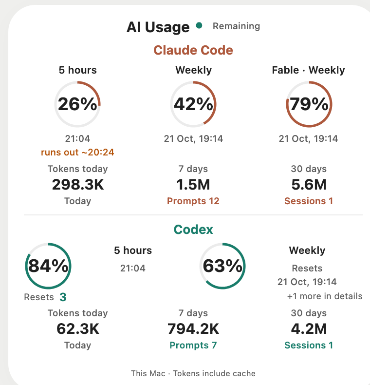
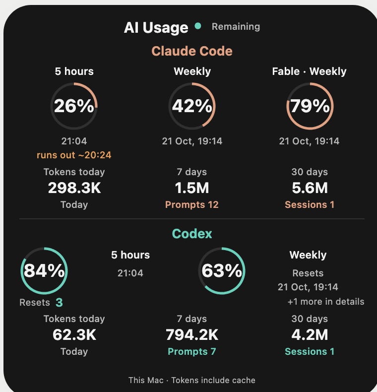

# AI Usage

Your Claude Code and Codex subscription limits on your iPhone, with local token and activity statistics.

**Mac → iCloud Drive → Scriptable.** No hosted backend, API key in the widget, or Apple Developer membership. Use Claude, Codex, or both. Widgets and the detail screen support **English and Russian**. New installations default to English. [Русская инструкция](README.ru.md).

This is an early community release. The widget has been used on a real iPhone; automated tests and browser previews do not replace testing every device size or iOS version. This project is independent of Anthropic, OpenAI, Apple, and Scriptable.

## Screenshots

<p>
  
  
</p>

Light and dark widget previews with fictional demo data. Actual quotas depend on your account.

## What it shows

- Account-wide remaining quotas and reset times, including every group the source returns. Small widgets show fewer rows; all groups are available in the detail screen.
- Available Codex reset credits, when supported by the installed Codex app-server. The collector never redeems them.
- Tokens today / 7 / 30 days, human prompts, unique sessions and active days from **this Mac's logs**. Tokens include cache reads; they are not a bill or an account-wide token allowance.
- History, stale/error indicators, light/dark themes, home-screen and lock-screen widgets.
- **Pace forecast:** at the pace of the last hour, *runs out ~20:24* appears under a limit when it would run out before its reset within the next 6 hours.
- **Notifications on the iPhone:** limit reset (when 80%+ was used), pace warning, a source that stopped answering, and a Mac that stopped sending data. Turn them off with `configure --notifications off`.

Data is collected every five minutes while the Mac is awake. Widget refresh is requested after 15 minutes; iCloud and iOS control actual delivery and refresh. Quota percentages are never converted into tokens.

## Requirements

- macOS on Apple Silicon or Intel, and **Python 3.12+** from [python.org](https://www.python.org/downloads/macos/) or your package manager.
- An iPhone with [Scriptable](https://scriptable.app/), and iCloud Drive enabled for Scriptable. Both devices must use the same Apple Account.
- Claude Code and/or Codex installed and signed in to the subscription you want to monitor. Sign in using the provider's own CLI/app; do not paste credentials into this project.
- Internet for provider reads and the first download of CodexBar CLI **0.56.7**. The installer verifies pinned SHA-256 checksums. No Python packages are required.
- Node.js 22+ is optional for development and previews, not for installation or collection.

Claude quotas come from CodexBar's own Claude CLI `/usage` session (`--source cli`). This depends on third-party CLI parsing and can break with upstream changes. Codex quotas come from `account/rateLimits/read`. Available windows depend on the account and installed CLI version; missing fields stay unavailable.

## Install

1. Install and open Scriptable on the iPhone once. Enable its iCloud Drive access.
2. Download and extract this repository's source ZIP (or the release ZIP), then open Terminal in that directory.
3. Choose your services:

   ```bash
   # Both services
   bash install.command --providers claude,codex

   # Or only the subscription you use
   bash install.command --providers codex
   # bash install.command --providers claude
   ```

   The time zone is detected from the Mac (UTC fallback). To choose explicitly:

   ```bash
   bash install.command --providers claude,codex --time-zone Europe/Paris
   ```

4. Check installation:

   ```bash
   "$HOME/Library/Application Support/AI Usage/bin/ai-usage" doctor
   ```

   `started: true` means the LaunchAgent was loaded. A `waiting_for_icloud` result means collection can continue locally until the genuine Scriptable folder appears.
5. Wait for **AI Usage** to appear in Scriptable on the iPhone, then run it. Add a Scriptable widget on the home screen; select **AI Usage**, action **Run Script**. Use `claude` or `codex` in its Parameter field. With only one configured service, that service is selected automatically.
6. For lock-screen widgets, add Scriptable in the lock-screen editor and select the same script.

The installer writes to `~/Library/Application Support/AI Usage`, creates `~/Library/LaunchAgents/local.ai-usage.collector.plist`, and writes `AI Usage.js` plus `AI Usage/snapshot.json` into the existing Scriptable iCloud folder. It does not install or update Claude Code or Codex. One collector per macOS user is supported.

The source ZIP can be removed after installation; keep the Python interpreter used by the installer. Running the installed launcher always uses that interpreter.

## Configure

Choose the interface language on the Mac:

```bash
"$HOME/Library/Application Support/AI Usage/bin/ai-usage" configure --language en
# Or: configure --language ru
```

It applies after the next collection. You can override one widget with `codex;lang=en` or `claude;lang=ru` in its Parameter field. The selected language also follows links to details. Old snapshots/settings without a language keep Russian. New installations can choose `bash install.command --language ru`.


Fresh installs show **all returned limits**, including Sonnet and Spark when present. No Fable row is invented by default.

```bash
# Change services; takes effect on the next collection
"$HOME/Library/Application Support/AI Usage/bin/ai-usage" configure --providers claude

# Optionally hide a name or ID (case-insensitive literal substring)
"$HOME/Library/Application Support/AI Usage/bin/ai-usage" configure --hide-limit codex:spark

# Restore hidden limits
"$HOME/Library/Application Support/AI Usage/bin/ai-usage" configure --show-all-limits
```

For paths, time zone, and optionally retained named windows, see [configuration](docs/configuration.md) and [example settings](examples/config.example.json). Credentials do not belong in configuration. Editing the synchronized Scriptable script is unnecessary and changes would be overwritten by the collector.

## Update and uninstall

Download the new source/release ZIP and run `bash install.command` again. Existing settings and history are retained. There is no automatic code updater. If Python moved, reinstall using the new interpreter.

```bash
# Collect now, or retry iCloud delivery without a provider query
"$HOME/Library/Application Support/AI Usage/bin/ai-usage" collect
"$HOME/Library/Application Support/AI Usage/bin/ai-usage" sync

# Remove programs and the LaunchAgent; retain local history and iCloud files
"$HOME/Library/Application Support/AI Usage/bin/ai-usage" uninstall
```

After uninstalling, remove the retained state folder and the two Scriptable files manually if you want to delete your history as well. Do not remove other Scriptable scripts.

## Privacy and limitations

Authorization remains with the providers' tools on the Mac. The collector reads local session logs to count activity but exports no prompt text, project paths, raw session IDs, email addresses, or auth tokens. The iCloud snapshot contains quota readings, daily counts, and hashed session IDs used to deduplicate sessions. These are still personal usage data: do not publish snapshots, databases, live previews, or screenshots without reviewing them. See [privacy and architecture](docs/architecture.md).

History is retained locally for 90 days; up to 30 days are synchronized to the phone. Token/activity history is imported from available local logs. Claude Max token totals across all devices are not available here. Other APIs, cost estimates, multiple accounts/Macs are outside this release. The forecast is a straight line through the last hour of readings, not a model of your habits; see [verification](docs/verification.md) for how it was checked.

## Development

```bash
make test          # Python + JavaScript; no accounts or network needed
make preview       # Synthetic data only; open artifacts/widget-preview.html
make check-public  # Public file/credential-pattern preflight
make dist          # Tests + preflight + ZIP, widget script and SHA256SUMS in dist/
```

Live previews require explicit `--live` or `--snapshot PATH`; generated artifacts are ignored by Git and excluded from releases. See [contributing](CONTRIBUTING.md), [troubleshooting](docs/troubleshooting.md), [release process](docs/releasing.md), and [changelog](CHANGELOG.md).

## License and credits

[MIT](LICENSE). CodexBar is downloaded separately under its own MIT license; see [third-party notices](THIRD_PARTY_NOTICES.md). Service subscriptions and separately installed applications remain subject to their own terms.
